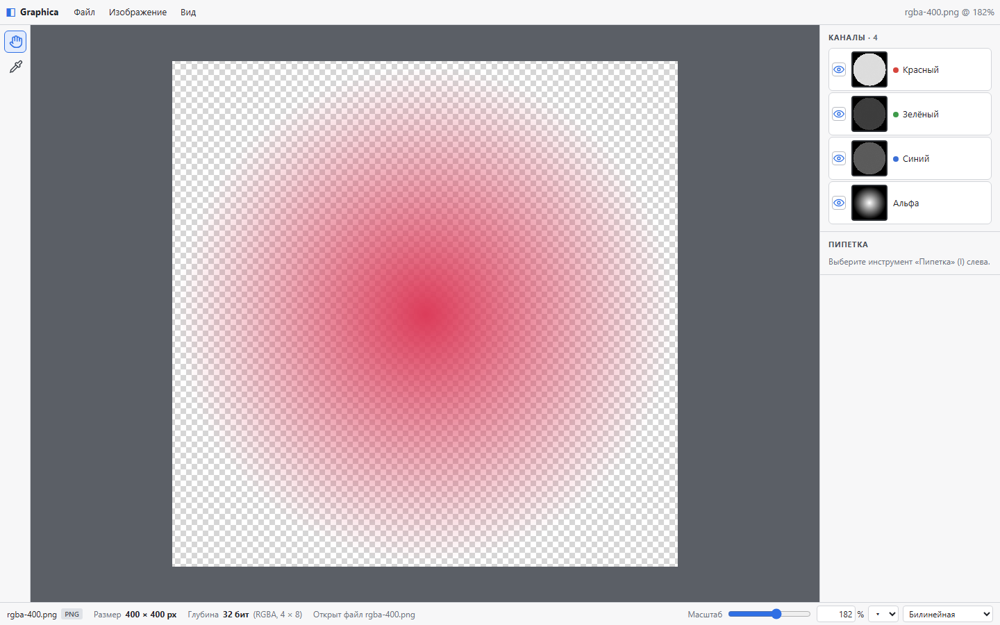
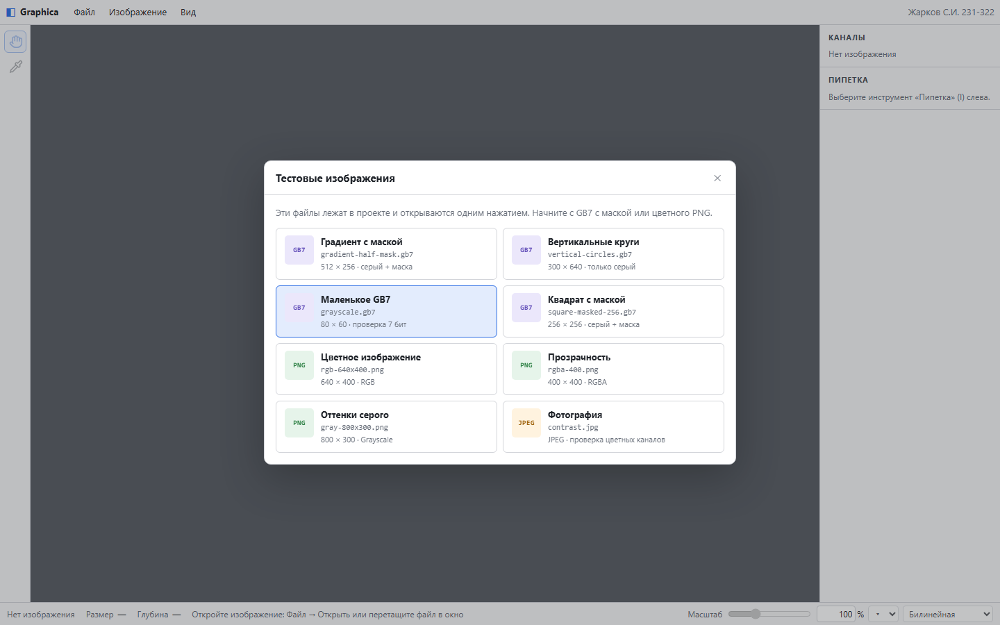

# Graphica — учебный растровый редактор

**Жарков Сергей Иванович**, группа **231-322**  
Дисциплина: «Технологии компьютерной графики»

**Демо:** [kipatich.github.io/photoshop-zharkov](https://kipatich.github.io/photoshop-zharkov/)  
**Репозиторий:** [github.com/Kipatich/photoshop-zharkov](https://github.com/Kipatich/photoshop-zharkov)

Веб-приложение для просмотра и обработки растровых изображений. Поддерживает PNG, JPG и учебный формат GB7, работу с каналами, уровнями, масштабированием и фильтрацией. Все алгоритмы обработки пикселей написаны вручную, без графических библиотек.



## Возможности

- открытие PNG, JPG и GB7 через меню, `Ctrl+O` или перетаскиванием;
- встроенная галерея тестовых изображений: **Файл → Тестовые изображения…** или кнопка на пустом холсте;
- собственный декодер и кодер GB7: 7 бит на пиксель плюс бит маски;
- сохранение в PNG, JPG и GB7;
- панель каналов с миниатюрами и включением/выключением каждого канала;
- пипетка с координатами, RGB, CIELAB и исходным 7-битным значением для GB7;
- уровни: гистограмма, чёрная/белая точки, гамма, LUT и предпросмотр;
- масштабирование от 12 до 300 % с интерполяцией «ближайший сосед» и «билинейная»;
- изменение размера изображения в пикселях или процентах;
- фильтрация ядром 3×3: предустановки, ручное ядро, нормировка, выбор каналов и стратегии краёв;
- свёртка в Web Worker с прогрессом и отменой предыдущего запуска;
- адаптивная раскладка для узких экранов.

## Лабораторные работы

### 1. Цифровое представление изображения

Формат определяется по сигнатуре файла, а не по расширению. Для GB7 читается 12-байтный заголовок с big-endian размерами, 7-битными значениями серого и маской. В строке состояния показываются имя файла, формат, размер и глубина цвета в битах на пиксель:

- GB7 без маски — 7 бит, с маской — 8 бит;
- PNG: Gray 8, Gray+Alpha 16, RGB 24, RGBA 32, 16-битные PNG — 48/64, палитровые — по bit depth;
- JPEG: 8 бит для grayscale, 24 бита для цветного.

### 2. Каналы и пипетка

Панель каналов показывает 1–4 миниатюры в зависимости от реального числа каналов изображения. Каждый канал можно скрыть или показать, не изменяя исходный массив пикселей. Если оставить только альфу, отображается маска. Пипетка (`I`) показывает координаты пикселя, RGB, CIELAB и сырые значения каналов.

### 3. Уровни

Диалог на основе `<dialog>`: Master и отдельные R/G/B для цветных изображений, Alpha при наличии. Гистограмма строится в диапазоне 0…127 для GB7 и 0…255 для 8-битных изображений, есть линейная и логарифмическая шкала. Настройки каналов сохраняются при переключении. Предпросмотр включён по умолчанию, «Сбросить» возвращает значения, «Отмена» закрывает без изменений.

### 4. Масштабирование

Собственные интерполяторы «ближайший сосед» и «билинейная» с общим интерфейсом. Масштаб меняется ползунком, полем ввода, готовыми значениями, колесом с `Ctrl`, клавишами `+` / `−` / `0` и через меню «Вид». При увеличении перерисовывается только видимая часть изображения. Диалог «Размер изображения» показывает мегапиксели до и после, поддерживает проценты и пиксели, сохраняет пропорции и проверяет ввод.

### 5. Фильтрация

Диалог с предустановками (тождественное ядро, резкость, Гаусс 3×3, прямоугольное размытие, Прюитт X/Y), сеткой 3×3, нормировкой, выбором каналов и стратегией обработки краёв (чёрный, белый, копирование). Перед свёрткой канал расширяется на 1 px, поэтому размер изображения не меняется. Свёртка выполняется в Web Worker.

## Стек

- React 18 + TypeScript;
- Vite 5;
- Zustand для состояния документа;
- Canvas 2D и Web Worker для обработки изображений.

## Запуск

```bash
npm ci
npm run dev      # разработка, http://localhost:5173
npm run build    # проверка типов и сборка в dist/
npm run preview  # просмотр production-сборки
```

Для сборки нужен Node.js 18 или новее.

## Структура проекта

```text
src/
  App.tsx                    состояние редактора и меню
  components/                рабочая область, панели, диалоги, строка состояния
  components/SamplesDialog.tsx галерея тестовых изображений
  core/raster.ts             модель изображения, каналы, миниатюры, пипетка
  core/formats/              загрузка и сохранение PNG/JPG/GB7, разбор заголовков
  core/interpolation.ts      интерполяторы, изменение размера, отрисовка видимой части
  core/levels.ts             гистограмма, LUT, гамма, применение уровней
  core/convolution.ts        ядра, расширение краёв, свёртка 3×3
  core/convolution.worker.ts свёртка в отдельном потоке
  core/filterRunner.ts       запуск и отмена задачи фильтрации
  store/imageStore.ts        исходное и текущее изображение
public/test-images/          тестовые PNG, JPG и GB7
```

## Тестовые изображения

В `public/test-images/` лежат изображения для проверки всех лабораторных. Открыть их можно прямо в редакторе: **Файл → Тестовые изображения…** или кнопка **«Тестовые изображения»** на пустом холсте — файлы загрузятся одним нажатием, без выбора из папки.



Например:

- `gradient-half-mask.gb7` — GB7 с маской на половине изображения;
- `vertical-circles.gb7` — вертикальное GB7;
- `large-ellipse-mask.gb7` — большое GB7 3000×1800 с маской;
- `grayscale.gb7`, `square-256.gb7`, `square-masked-256.gb7`;
- `rgb-640x400.png`, `rgba-400.png`, `gray-800x300.png`, `gradient.png`;
- `contrast.jpg`, `large-4000x2600.jpg`.

## Публикация

### GitHub Pages

Сайт опубликован: [kipatich.github.io/photoshop-zharkov](https://kipatich.github.io/photoshop-zharkov/). В репозитории есть workflow `.github/workflows/deploy.yml`: после push в `main` GitHub Actions пересобирает проект и обновляет страницу автоматически. Источник публикации в настройках репозитория — **Settings → Pages → GitHub Actions**.

### Хостинг ИТ-факультета

У Московского Политеха есть бесплатный хостинг для студентов: [fit.mospolytech.ru/systems/infrastructure](https://fit.mospolytech.ru/systems/infrastructure). После регистрации и получения доступа к серверу содержимое папки `dist/` загружается по SFTP в каталог сайта, указанный в письме. Подробная инструкция — в [DEPLOY.md](DEPLOY.md).

## Автор

Жарков Сергей Иванович, группа 231-322, Московский Политех.
